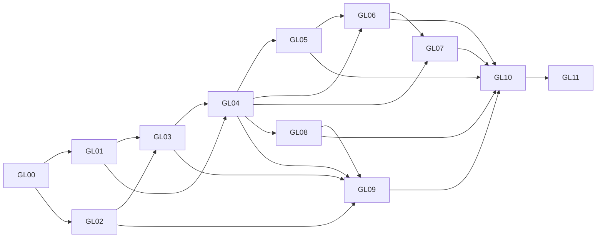

# Work packages and dependency handoffs

EX33 authorizes implementation beginning GL00 with Terra ownership and independent Sol review, following the latest user instruction. Current package status and assignments are in plan.json. The descriptions below remain acceptance obligations; they do not grant additional acceptance to the existing WP or MP packages. Owners can use contract-bound fixtures before dependencies finish; acceptance requires integrated dependency outputs. The orchestrator owns the final shared contract and acceptance decision; the author cannot approve their own change.

## Sequence and ownership

| Package | Owner | Supporting agent | Independent review | Accepted-output dependencies |
| --- | --- | --- | --- | --- |
| GL00: Scope and launch baseline | Terra | Orchestrator | Sol | None |
| GL01: Lean records and claim contracts | Terra | Orchestrator | Sol | GL00 |
| GL02: Broad source inventory and exploration design | Terra | Orchestrator | Sol | GL00 |
| GL03: Bounded acquisition and discovery frontier | Terra | Orchestrator | Sol | GL01, GL02 |
| GL04: Reviewed admission and public projection | Terra | Orchestrator | Sol | GL01, GL03 |
| GL05: Search, browse and ordering | Terra | Orchestrator | Sol | GL04 |
| GL06: Homepage, navigation and compact results | Terra | Orchestrator | Sol | GL04, GL05 |
| GL07: Work, account, creator and institution journeys | Terra | Orchestrator | Sol | GL04, GL06 |
| GL08: Maintenance, corrections and suggestions | Terra | Orchestrator | Sol | GL04 |
| GL09: Regional breadth and miss audit | Terra | Orchestrator | Sol | GL02, GL03, GL04, GL08 |
| GL10: Reader, accessibility and technical qualification | Terra | Orchestrator | Sol | GL05, GL06, GL07, GL08, GL09 |
| GL11: Exact-candidate go-live and operational acceptance | Orchestrator | Terra | Sol | GL10 |

After GL00, develop GL01 and GL02 in parallel. With a shared GL01 contract, UI and search prototypes can overlap GL03. After the first GL04 batch, run search/UI, corrections and further acquisition in parallel. GL09 feeds actual breadth findings back into GL02–GL05; GL10 feeds reader findings back into GL05–GL08. Each reopened dependency must be reaccepted before its consumer's acceptance is restored.

## GL00 — Reconcile scope, operating baseline and launch authority

**Goal:** Make the direct go-live scope executable without restarting completed engineering work or inheriting obsolete pilot prerequisites.

**Work:** Inspect the exact branch, current runtime instructions, existing production configuration references and source qualifications without activating anything. Record the code/lock/build baselines, current public route and feed meanings, and limits of older receipts. Inventory current discovery source, transport, private storage, projection, review and UI capabilities. Identify the existing maintained correction channel and accountable operator. Separate missing business/release decisions from routine implementation choices already delegated to the orchestrator.

Freeze launch G01–G07, the nine-county boundary, lean admission minimums, public/private field boundary, planned source routes and reader tasks. Resolve whether the first release uses the existing reviewed snapshot path or needs a limited materialized index. Preserve the automated system's unfinished WP14/WP16 and benchmark status. Record the explicit EX32 route from reviewed snapshot to go-live; an old MP04 hold must not make future public-pilot branding a requirement.

**Outputs:** `docs/discovery/go-live/execution/GL00-baseline.md`, source/runtime inventory, compatibility checklist, role/channel assignments and a launch decision register. These are future paths.

**Acceptance:**

- GL00-A1: Code and evidence baselines are exact; unavailable production facts are recorded, not guessed.
- GL00-A2: All seven priorities and the user's breadth/paper-optional constraints have implementation and evidence owners.
- GL00-A3: The release path separates this plan, future implementation, source acquisition, recurring operation and deployment authority.
- GL00-A4: No complete-person, linked-paper, star threshold, journal status, universal bespoke-permission or independent-benchmark gate is imposed on basic listings.
- GL00-A5: Candidate data remains private and legacy route/feed obligations are enumerated before navigation changes.

**Adaptation:** Missing old runbooks require finding an accepted current replacement before runtime work. An absent correction channel returns a concrete low-cost channel choice to GL08. Neither finding prevents unrelated schema/UI planning. Reopen GL00 when launch scope or operational authority changes.

## GL01 — Freeze the minimum useful record and claim contracts

**Goal:** Preserve just enough supported information for a useful decision and link, including paperless work and unresolved optional contributors.

**Work:** Extend existing strict DTOs through a new version where required. Separate native fields, curated purpose/topic labels, dated regional context, source-scoped owner/authors, professional links and typed artifact relations. Define stable provider identity, optional work grouping, canonical URLs, provenance and review decisions. A local institution's documented software can qualify without identifying every developer. Unknown author identity or employment is not filled from an account name.

Define private candidate/frontier schemas separately from public records. Define positive, negative and unresolved relevance/regional outcomes. Bind facts to exact source observations and dates. Validate short curated explanations as reviewed interpretations with sources; do not store them as native text. Public serialization must allowlist fields and exclude candidates, contacts, credentials, reviewer internals and private paths.

Freeze source-date/first-seen/last-checked distinctions, archive/fork labels and field-specific corrections. Topic labels form a small editable vocabulary, not an exhaustive ontology. Source-qualified facts control admission; a language model can propose classifications or wording, but cannot authorize publication.

**Outputs:** Versioned schema and interface proposal, inclusion matrix, old-to-new field mapping, minimum/optional field table, topic/alias revision and contract examples. Architecture gives implementation anchors.

**Acceptance:**

- GL01-A1: Positive examples cover paperless user-owned code, institution/lab-owned code, a standalone paper/preprint and incomplete optional authors.
- GL01-A2: Negative cases include generic AI, hospital-dataset geography, starred repositories, same-name merges and unsupported campus/headquarters transfers.
- GL01-A3: All public claims have permitted sources and correct temporal meaning; unknown county and current role remain unknown.
- GL01-A4: A lean record requires no biography, photograph, complete affiliation history, publication relation or known software license.
- GL01-A5: Native changes and curated facts remain distinguishable; source/identity/hash/date substitutions fail the changed contract.

**Adaptation:** If lean admission needs more fields than the reader uses, remove optional fields from the release requirement. If a source cannot support a required claim, hold that candidate or seek another route; do not lower the evidence rule. A schema change after freeze reopens affected GL03–GL10 work.

## GL02 — Design discovery for breadth

**Goal:** Search the region's less visible work through repeatable, diverse routes rather than through a handpicked list of prominent papers.

**Work:** Build a sourced county/campus/institution/lab/account inventory and a versioned discovery frontier. Include both organization and individual GitHub owners, existing repositories with few or zero stars, archived work and sources without papers. Investigate departments, lab software pages, project documentation, campus directories, association/community leads and publication code-availability links. Validate account affiliations separately from repository metadata.

Use the coverage strategy to freeze an initial bounded exploration, named query families, access methods, page/budget limits, exclusions, known-project checks and denominators. Enumerating supported accounts must complement topic search; quiet projects cannot disappear solely because their titles lack fashionable terms. Plan independent publication/preprint discovery so GitHub is not a universal prerequisite. Record forum access gaps separately from other routes.

**Outputs:** Proposed `source-inventory.json`, `exploration-manifest.json`, `frontier.jsonl`, provider capability/terms matrix and known-project diagnostic set in the appropriate private/portable locations selected at GL00.

**Acceptance:**

- GL02-A1: All nine counties have an exploration entry and sourced campus/location reasoning or an explicit unresolved inventory gap.
- GL02-A2: Both account enumeration and topical/independent-source lead discovery are planned; no paper, prestige, news, star or recent-push filter controls eligibility.
- GL02-A3: Source access and field-use basis are specified per method; credentials are references, never document values.
- GL02-A4: Caps, truncation states, follow-up policy and expected evidence are fixed before collection.
- GL02-A5: The diagnostic set contains diverse acquisition paths, including a paperless and a user-account example where support can be found. Unavailable cases are recorded rather than invented.

**Adaptation:** A blocked forum can be deferred with a precise gap. A provider-search ceiling requires supported partitioning, account enumeration or an explicit incomplete outcome. Move effort toward neglected routes after observing yields and misses; preserve the original exploration manifest.

## GL03 — Acquire candidates with a durable, bounded frontier

**Goal:** Produce a reproducible candidate stream with explicit discovery gaps and no automatic public publication.

**Work:** Reuse accepted registry, request guards, transport, budgets, identity and checkpoint components where their actual contracts match. Qualify exact provider endpoints and selected fields before real requests. Persist seed, query, page ancestry, stable native ID, observation time, discovery reason and final outcome. Each source method reports completed, exhausted, truncated, blocked, rate-limited, malformed or unavailable distinctly.

Implement account-list traversal and independent topic/publication/institutional leads. Keep repository-to-paper citations and paper-to-code links directional. Deduplicate by provider identity, with explicit aliases and fork/mirror relations. Preserve a review queue so low-visibility work is not silently dropped when review capacity is exhausted. Bound both candidates retained and requests consumed; a full queue stops further acquisition or records a defined partial result.

Start with explicit operator-run batches. Scheduling is a later measured decision. Captures must exclude disallowed text and unnecessary personal/contact data. Retain only what the chosen method permits; approved factual observations can be alternatives to copied bodies when reproducible under that method.

**Outputs:** Collector/frontier integration, candidate outcomes, exact qualification receipts, small real batch and replay/crash evidence within authorized acquisition scope.

**Acceptance:**

- GL03-A1: Real supported account enumeration and independent topical discovery yield source-scoped candidates with replayable origins.
- GL03-A2: Independent publications can enter without repositories; paperless/user-owned repositories are retained for review.
- GL03-A3: Pagination caps, duplicates, rate limits and queue limits cannot become healthy-empty or complete-coverage results.
- GL03-A4: Crash/restart and budget checks preserve durable progress without duplicate publication or unauthorized requests.
- GL03-A5: No candidate, provider success or model result can write the public release manifest directly.

**Adaptation:** Use a bounded operator-approved manifest as a transitional frontier if an existing durable component has incompatible semantics. Document the limitation and explicit restart behavior. New provider support requires qualification, not an ad hoc unrestricted HTTP helper.

## GL04 — Review lean records and build the public projection

**Goal:** Turn useful supported candidates into a versioned, correct public catalog without demanding exhaustive dossiers.

**Work:** Implement a small review/change workflow, initially PR-based if sufficient. Each proposed record includes identity, health-tech reason, regional reason, permitted original links, dates and claim sources. Record accept, hold, duplicate, outside-scope, correction or removal decisions. Operator and reviewer roles may be filled by the orchestrating engineer and assigned agents under existing authority; no two-human benchmark annotation is required for ordinary listing review.

Build a deterministic allowlisted release projection from reviewed decisions. Validate exact source and relation bindings. Keep source-reported author rosters optional in the card and source-specific in deeper views. Preserve historical records; compare old/new projections and explain record/field changes. Tie coverage counts to the same public projection generation.

This path remains distinct from the unfinished general WP14/WP16 authenticated live admission system. A PR-reviewed snapshot can launch. Adding dynamic public mutation requires the appropriate authority, transaction and invalidation work before activation.

**Outputs:** Review manifest and validator, deterministic builder, public DTO/API, change report and admitted real records from independent routes.

**Acceptance:**

- GL04-A1: The exact generated projection reproduces from selected permitted evidence and reviewed decisions.
- GL04-A2: Paperless and standalone publication entries pass; weak regional/relevance candidates stay private without disappearing from the frontier.
- GL04-A3: Author/account/institution identities, relationship directions and date precision remain correct in API and HTML.
- GL04-A4: Bad source pointers, forged reviews, duplicate identities, malicious links and unintended extra fields fail closed.
- GL04-A5: Records, related support objects and verified project groups have distinct counts; no inferred people or project total is advertised.

**Adaptation:** A minimal review patch can unblock useful records without building a full editorial UI. If review is repetitive or expensive, measure the cause before automating it. A projection too large for the measured envelope triggers the architecture storage/index decision.

## GL05 — Make ordinary search and browsing useful

**Goal:** Find relevant work from topics, places, institutions and source names without requiring an exact title or introducing opaque factual inference.

**Work:** Freeze a query-task set from known content before tuning. Add reviewed topic concepts and aliases such as machine learning/ML under an AI topic where supported. Preserve exact DOI/repository/native-ID lookup, literal names and governed institution aliases. Short acronyms need token-aware matching; `AI` must not match merely because the letters occur in `brain`.

Support compound queries and visible subject, institution, county and kind facets. Distinguish county-associated work from current people in a county. Explain the source of a match and keep one supported relationship hop where useful. Define the nonempty-query default ordering around actual match strength, stable dates and stable identity, with no star/prestige boost. Define behavior for unknown dates and withdrawn entries.

Reuse existing TypeScript/Zod/query modules first. A hosted search engine, embeddings or chatbot are not default requirements. Preserve URL/back/reset state and keyboard use. State the supported search style in examples; a topic search box need not pretend to understand arbitrary natural language.

**Outputs:** Query specification, topic/alias manifest, API/facet changes, ranking explanation, frozen task results and adversarial regression cases.

**Acceptance:**

- GL05-A1: `sleep`, `Camden sleep`, `sleep AI`, the three existing full county phrases and Rutgers-Camden variants return the supported records at the intended filters.
- GL05-A2: Exact IDs and all existing nine citation pairs retain correct lookups after changes.
- GL05-A3: `AI` does not admit unrelated substring-only hits; unsupported cross-project/county combinations cannot manufacture a relationship.
- GL05-A4: Facet counts and result/support counts describe the same generation and correct relation semantics.
- GL05-A5: Frozen findability tasks, empty/error states, reset and stable ordering pass without changing expected answers to excuse a miss.

**Adaptation:** Start with curated topics and explicit aliases. If readers still miss useful work, record whether the cause is missing content, vocabulary, ranking or presentation. Repair that cause before adding a more complex retrieval system.

## GL06 — Make discovery the front door and results compact

**Goal:** A reader can understand the site and reach useful work from the homepage quickly.

**Work:** Change homepage and primary navigation to lead with discovery. Add restrained entry points for subjects, institutions, counties and newly found work. Use The Valley Desk product language, not public pilot labels or a promise of comprehensive knowledge. Preserve News/Events/Watch URLs and feeds; move their visual priority only after compatibility review.

Render cards around supported purpose, health-tech reason, dated regional connection, original actions and last checked. Avoid repeating long author lists and caveats on the card; retain material qualifications and disclose deeper evidence accessibly. Label archived/superseded status when supported. Distinguish source publication/push dates from discovery/check dates. Show enough fields for an internal researcher to decide to open code, docs or a paper.

**Outputs:** Home/navigation/card components, responsive layouts, empty/error/partial states, product copy and legacy-consumer verification.

**Acceptance:**

- GL06-A1: From `/`, a reader can search and open work without knowing `/discover` exists.
- GL06-A2: Cards answer purpose, regional reason and next action with inspectable sources; optional missing fields do not create empty-dossier layouts.
- GL06-A3: No public pilot branding, unsupportable local-person counts or comprehensive-coverage language remains in the launched journey.
- GL06-A4: Keyboard, narrow-screen, long-title and missing-field cases remain usable.
- GL06-A5: Existing required URLs, feeds and route meanings remain correct; changes are explicitly mapped rather than silently removed.

**Adaptation:** Prototype one useful repository, one standalone paper and one incomplete record first. Inspect those before building every page variant. Reopen the card contract if readers confuse authorship, ownership, dates or geography.

## GL07 — Add lean detail and creator/institution paths

**Goal:** Readers can follow a useful connection and reach a public project or professional destination without requiring a full social graph.

**Work:** Provide stable work detail/permalink views with short purpose, source links, supported relations and dates. Add lean institution and source-scoped creator/account views only where supported. Lists can group work by evidenced institutional association while keeping historical periods and uncertain people distinct. If identity resolution is uncertain, link to the source-scoped author occurrence or account rather than create a merged person page.

Professional links are optional, passive and individually supported. Do not harvest email addresses, infer contact preferences or require a photograph/biography. Code/documentation/publication actions are sufficient next steps when a creator link is unavailable. Preserve search/facet/back state, canonical metadata and truthful crawlability.

**Outputs:** Detail/grouping routes, verified link model, identity uncertainty presentation, route mapping and example journeys.

**Acceptance:**

- GL07-A1: A paperless repo, a standalone paper and a multi-institution collaboration each provide a useful detail-to-source journey.
- GL07-A2: Unsupported account-to-person merges and current-role claims cannot appear.
- GL07-A3: At least one supported institution path and one source-scoped creator/account path work; unresolved individual identity does not block the work page.
- GL07-A4: Missing professional links fall back to useful original work links without invented contacts or disabled empty actions.
- GL07-A5: Permalinks, back navigation, page titles, removed-record responses and crawler fields preserve the intended identity and state.

**Adaptation:** Prefer a filtered institution result page over an elaborate profile if it serves the task. Build a global person identity only after evidence and reader need justify it.

## GL08 — Make additions, corrections and upkeep manageable

**Goal:** Maintain the index through a small, observable workflow.

**Work:** Assign a maintainer and reviewer or documented safe fallback. Add a visible Report an issue/Suggest work action to an existing maintained channel verified at GL00. A custom public form is optional; if used, rate-limit and bound input, avoid unnecessary personal data, and keep reports private/untrusted until reviewed.

Implement candidate triage, small update batches, source-check outcomes, field correction/removal, duplicate handling and retraction/tombstone rules. Unsupported optional facts can be removed without deleting an otherwise useful record. Failed rechecks do not prove a project ended and do not renew current claims. Produce a new reviewed projection and search view together; purge old rendered/cache content as needed.

Use a proposed manual cadence and measured workload first. Current code contains accepted evidence/removal components, but the launched path must demonstrate its own end-to-end behavior. Preserve a minimal restricted removal ledger outside older rollback artifacts so a rollback cannot resurrect withdrawn facts.

**Outputs:** Intake destination, operating assignments, triage/recheck records, reviewable change workflow, update/removal tests, cache/invalidation instructions and workload report.

**Acceptance:**

- GL08-A1: A reader can reach a working report/suggestion destination from a record without being asked for a complete research dossier.
- GL08-A2: New leads remain untrusted; submitted text cannot authorize publication or become public metadata automatically.
- GL08-A3: An update and a field/record removal propagate through list, detail, search, counts and applicable crawler/cache outputs in an isolated rehearsal.
- GL08-A4: Last checked means the relevant check occurred; failed checks and stale claims are distinguishable.
- GL08-A5: Actual maintenance effort/backlog is recorded; the next batch fits an explicit operating budget or has a reviewed adjustment.

**Adaptation:** Keep PR/manual operation when sufficient. Add an operator UI or scheduled checks only when observed backlog and source qualification justify them. An actual privacy/attribution problem interrupts the cadence and holds affected records.

## GL09 — Demonstrate breadth and investigate misses

**Goal:** Demonstrate a useful exploration process and repair predictable blind spots before launch.

**Work:** Execute the frozen bounded exploration within its authorization. Review the actual county/route/account outcomes, source truncation, candidates held and new useful admissions. Independently try to find known eligible projects through the intended routes. Investigate every miss in the declared explored inventory. Check whether search/topic selection or review silently excludes paperless, user-owned, low-star, archived or non-news work.

Prioritize outer Pennsylvania counties and Burlington alongside the new Mercer/Camden/Gloucester connections. Do not turn administrative county quotas into fabricated evidence or make density equal across counties. Publish a concise explored-source and gap summary, with dated internal details and a next-batch frontier. First-seen novelty and substantive independent projects are distinct from raw acquisition counts.

**Outputs:** Actual exploration ledger, miss classifications and fixes, bias/missingness report, accepted gap dispositions and the next discovery batch.

**Acceptance:**

- GL09-A1: Every planned county exploration has an actual result, blocked/unavailable outcome or explicitly reviewed defer with a next action.
- GL09-A2: The resulting admitted set demonstrates a paperless repository, a user-owned repository, a non-headline/low-visibility discovery and a standalone publication/preprint when accessible. One record can satisfy several properties; evidence cannot be invented to satisfy the checklist.
- GL09-A3: A supported non-Philadelphia Pennsylvania connection is added, or exhaustive-within-scope attempts and a substantive geography-gap review decide the launch impact. The service must not claim that missing geography is covered.
- GL09-A4: Known eligible misses within declared explored sources are fixed and rerun. An unsearched/blocked source is not reported as exhausted or as absence of work.
- GL09-A5: Admission, duplicate, candidate, project and person counts remain distinct; no search result total is advertised as regional recall.

**Adaptation:** Fix a systematic bias rather than merely adding one handpicked example. A documented unavoidable source gap can narrow a coverage claim with Sol/orchestrator review. Removing paperless or individual-account support would contradict the user's goal and requires a new scope decision.

## GL10 — Verify useful journeys and technical quality

**Goal:** Demonstrate that the launch candidate supports the intended recurring research tasks, with realistic access and operating behavior.

**Work:** Freeze the task set and device/data envelope before evaluation. Run independent task attempts, including unfamiliar/quiet projects and sparse records. Prefer actual available internal users; do not invent participants or perform outreach without its scope. Orchestrator/agent demonstrations can supply engineering evidence but cannot be presented as human reader validation.

Test keyboard/focus, a screen reader, mobile and desktop, at least a second supported browser, contrast, accessible names, source actions, error/no-results states and back navigation. Measure load/search/payload behavior on the actual intended catalog and a justified growth envelope. Run source/privacy/authorization checks for the changed public/intake boundaries. Preserve full existing application/PDF/build/smoke/audit/secret gates where affected by implementation.

**Outputs:** Executed task records, accessibility/browser/performance findings, adverse-case results, exact revision and corrected blocking findings. Use the [validation plan](validation.md).

**Acceptance:**

- GL10-A1: Every critical J01–J08 task in the scoped release has observed evidence or an explicit, justified non-applicability decision before acceptance.
- GL10-A2: Actual reader feedback is distinguished from agent/software demonstrations; failed tasks are repaired and repeated without changing the original success definition.
- GL10-A3: No known material attribution, private-data exposure, unsafe publication, essential interaction or recovery defect remains.
- GL10-A4: Accessibility, browser and performance results bind to the actual candidate and declared envelope; missing tools or results cannot be labeled pass.
- GL10-A5: All required implementation checks and exact-head CI pass, with receipt scope and residual gaps independently reviewed.

**Adaptation:** Classify failures as missing content, vocabulary/ranking, presentation, evidence confusion or operations. Reopen the smallest causal package and its affected consumers. A small usability exercise is not the original independent benchmark and need not become one.

## GL11 — Prepare and execute direct go-live

**Goal:** Release The Valley Desk's useful discovery service to internal and public readers, then verify what is served.

**Work:** Assemble the exact candidate, current configuration/bindings, permitted source methods, artifact hashes, projection generation, compatibility results, maintenance/correction assignments and rollback target. Verify that source data and internal queues stay out of public assets/outputs. Review user-facing language and crawler/indexing choices for a direct public service rather than a public pilot.

Rehearse release and rollback in isolation, including removal-ledger reconciliation. A static snapshot launch should not acquire new databases, migrations, cron jobs or paid services without a demonstrated requirement. If a chosen design introduces them, specify additive migration and recovery behavior, test it and obtain the relevant operational scope.

Prepare the complete reviewable release packet before any required deployment decision. After explicit applicable release authorization, deploy only that candidate, read back actual homepage/search/detail/source/correction/coverage and legacy behavior, verify served identity and observe errors. Keep public operation acceptance separate from a successful deployment command.

**Outputs:** Exact release candidate, release/runbook, stopping thresholds, rollback rehearsal, actual deployment/readback record and operating handoff when authorized. They do not exist merely because this plan lists them.

**Acceptance:**

- GL11-A1: Exact candidate and all applicable evidence/CI/configuration identities agree; material drift reopens review.
- GL11-A2: Product language is ready for direct go-live; supported functionality and coverage gaps are clear without public-pilot branding.
- GL11-A3: An accountable maintenance path and correction action exist; harmful attribution/exposure, failed rollback or unresolved release-scope authority blocks deployment.
- GL11-A4: Authorized deployed identity and actual public journeys are read back successfully, including legacy consumers.
- GL11-A5: Failed public checks trigger the reviewed stop/correct/rollback path, and resulting state is verified without reviving removed claims.

**Adaptation:** A source collection problem can pause future intake while permitted useful reviewed records remain available. An unsafe public claim or privacy fault holds affected display. Do not use a partial source failure to shut down unrelated healthy routes without evidence. A release that needs correction remains an observed failure until retested.
