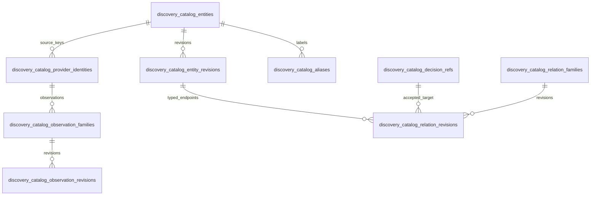

# WP04 implementation handoff — Sol

Draft implementation complete for independent review; acceptance remains dependent on WP02 acceptance and orchestrator adjudication. Baseline is `c8b36d7e9b27376bf121d9d6670c500a25c62423`. This is local synthetic engineering evidence; it establishes no source truth, provider qualification, editorial authority, public admission, migration rollout, or deployment.

## Surface and ownership

`src/content/discovery-catalog.ts` consumes shared WP02 IDs, provider identities, dates and revision references. It defines strict, discriminated person, organization, account, project and artifact variants. Artifact subtypes are repository, publication and discussion. People and organizations need no account, employer, artifact or project. A publication needs no repository/project. Account identity cannot change under an existing catalog ID. A project remains optional.

`src/ingest/discovery-store.ts` provides internal catalog writes, identity binding, observation revisions, evidence/decision anchor registration, relations, aliases, entity readback and an unpublished reservation. It exports no HTTP handler, acquisition function, scheduler or worker. Callers must construct actual review authority from verified server context in the later protected API. A valid authority-shaped object or accepted synthetic decision is not proof of authentication.

`migrations/0041_discovery_catalog.sql` adds only discovery tables, indexes, a union-head view and triggers. Existing Watch/news columns and geographic meanings are preserved. Root owns migration/SCHEMA_VERSION integration and package/CI wiring. No shared WP02 file is modified by this package.

## Identity and graph



A provider identity is SHA-256 over canonical JSON of `[provider, installation, kind, nativeId]`, prefixed `provider:`. The exact four-column tuple also has a database UNIQUE constraint. Internal subject IDs remain separately assigned; the same source tuple cannot be rebound to another subject. Display names, handles, paths and repository owner/name are aliases and never identity keys. Native IDs preserve spelling; provider parsers must supply true source-native stable IDs rather than handles. A rename or transfer changes metadata/aliases, while a fork or genuinely different native ID is a different identity.

For example, GitHub installation `github.com`, account native ID `42` remains bound to `account:42` through a handle rename. A repository native ID `repo-42` stays bound to `repository:42` through an owner/path transfer. Two subjects can each have the exact alias `@same-handle`. An accepted equivalence relation can link two same-kind subjects; retraction creates a new immutable relation revision. It never collapses or deletes either identity. DOI/PMID/arXiv equivalence requires that same explicit reviewed relation; no automatic cross-provider collapse exists.

Endpoint rules are enforced both in Zod and SQL CHECK/FK constraints:

| Relation | From → to |
| --- | --- |
| attribution | person/organization/account → artifact/project |
| account-ownership | person/organization → account |
| affiliation | person → organization |
| project-membership | artifact → project |
| artifact-version | artifact → a distinct artifact with the same artifact subtype |
| equivalence | same subject kind → a distinct subject; artifact subtypes must also match |

Artifact endpoints explicitly carry `artifactKind`, checked against the stored immutable entity subtype. Both inferred TypeScript types and runtime schemas constrain each relation endpoint; version/equivalence pairs are unions of matching subject kinds and matching artifact subtypes. A repository cannot become a publication through either relation. A preprint and journal paper can retain distinct publication identities connected by a reviewed link; a reviewed equivalence still never silently merges them. Citation/association is a different future relation meaning.

Relations pin exact endpoint revisions and require one or more registered evidence revision anchors plus an accepted stored decision targeting the exact relationship ID/revision. A decision for a different target or revision cannot satisfy the trigger. Relation payload and SQL endpoint/reference columns must agree. These constraints do not independently prove the evidence supports the relationship. Historical endpoint references remain valid provenance; later public commits must additionally guard their complete *current* dependency vectors.

## Revision and transaction contract

Entity, observation and relation revisions are append-only, with a positive monotonic head per family. Initial head revision is 1; subsequent updates advance exactly one. The write operation's expected revision is null for a missing head and positive otherwise. Null is an absence sentinel in this internal write API, never a `Revision` value. A value returning A→B→A advances twice.

Each write uses one actual D1 batch: insert SQL guard, insert family/revision rows, advance its head, then insert its durable operation result. The SQL guard raises `discovery-stale-revision` when the head differs from the expectation. It also rejects conflicting reuse of an operation ID. Successful replay uses the retained request hash and skips all mutation statements, even after later head advances. The final operation trigger verifies the resulting head matches the planned revision. Head triggers require an outstanding matching guard. Failures produce `DiscoveryCatalogConflict`, retaining the database's specific failure in its message/cause.

The request digest uses canonical object-key ordering. A new operation ID cannot overwrite an existing revision with incompatible data. Both ordinary UPDATE/DELETE and conflicting INSERT OR REPLACE are guarded: SQLite can suppress implicit REPLACE delete triggers when recursive triggers are disabled, so immutable payloads and existing heads have explicit BEFORE INSERT guards too.

An initial `discovery_publication_reservations` row has positive revision 1 and generation 0, with no public row. Replaying the same reservation is idempotent; a conflicting subject is rejected. This reservation is only a durable anchor. The subsequent projection package must add and qualify real publication heads/CAS, full dependency guards, authority checks, generation/epoch updates and opaque snapshots. WP04 does not claim those later publication guarantees.

## Dates and geography

All source-date precision, interval construction and containment use WP02 shared helpers unchanged. Calendar intervals retain calendar coordinates rather than invented UTC events; instants require offsets and filter against UTC date boundaries. The source year, month and unknown date are retained in immutable JSON. Date filtering does not establish contribution location across a relocation.

| Source | Filter, half-open | Result |
| --- | --- | --- |
| year 2024 | 2024-02-01 → 2024-03-01 | false |
| year 2024 | 2024-01-01 → 2025-01-01 | true |
| month 2024-02 | 2024-02-01 → 2024-03-01 | true |
| month 2024-02 | 2024-02-02 → 2024-03-01 | false |
| day 2024-02-29 | 2024-02-29 → 2024-03-01 | true |
| instant 2024-02-29T23:00:00-02:00 | 2024-02-29 → 2024-03-01 | false |
| unknown | 2024-01-01 → 2025-01-01 | false |

Affiliations retain exact state-qualified county text or null, basis, effective bounds, checked time and expiry in revision JSON and county text in an indexed column. Explicit outside counties remain explicit outside values; unknown remains null. `discoveryAffiliationIsCurrentLocal` recognizes only the exact nine county keys, active professional basis, known effective start/end, and unexpired affirmative evidence checked no later than the query time. Exact expiry is excluded. Residence, membership, unknown end and future checks do not establish current presence. `validFrom`/`validUntil` bound the supported professional-presence assertion, not an asserted employment termination. A future WP14 currentness assessment may have a bounded, explicitly evidenced and policy-governed validity horizon while an underlying employment end stays unknown in its own claim record. It must retain that distinction and provenance. Do not copy an arbitrary freshness expiry into a factual employment end, invent a job end to satisfy this helper, or derive a supported interval merely from observation time. `expiresAt` separately bounds this assessment’s usable freshness. When the supported assertion interval itself is unknown, this helper returns false and WP14 must retain/resolve the unknown rather than fabricate a bound.

This pure temporal helper does not admit a profile; admission still needs qualified evidence and current authorized decisions. Independent professional geography and work-at-creation claims belong to WP05/WP14 and cannot be inferred from a current affiliation or catalog metadata.

## Immutability and rights-removal boundary

Evidence anchors store only `(id, revision)`. This catalog stores bounded normalized metadata, aliases, hashes, relationship metadata and decision provenance; it stores no private raw content, fetched body, snippet, figure, code, data or weight. The metadata write API is internal and cannot itself establish that input is public or retention-permitted; later qualified collectors must enforce that boundary before calling it.

WP05 must place retained source material in a separately removable store. A rights-removal operation must remove prohibited material and invalidate dependents while preserving only permitted tombstone/audit references. Immutability is not a retention-rights exemption. If a field currently held as catalog metadata itself must be removed, use a separately reviewed, scoped rights-removal migration/API with authenticated authority and an audit receipt; do not disable these triggers or treat ordinary UPDATE as a redaction path. This package deliberately supplies no unauthenticated deletion bypass.

## Executed evidence

The focused command uses installed Node 22 and workspace-only temporary/config/cache paths:

```sh
PATH=/workspace/build/builderbob/runtimes/node-v22.23.2-linux-x64/bin:$PATH \
TMPDIR=$PWD/.discovery-work/tmp XDG_CACHE_HOME=$PWD/.discovery-work/cache \
XDG_CONFIG_HOME=$PWD/.discovery-work/wp04/config XDG_DATA_HOME=$PWD/.discovery-work/wp04/data \
node --import tsx/esm --test --test-concurrency=1 test/discovery-identities.test.ts
```

The test invokes Wrangler's existing `getPlatformProxy` with a fake database ID, `envFiles:[]`, `persist:false`, `remoteBindings:false`. It applies every legacy migration 0001–0040, captures legacy schema definitions and a Watch sentinel, applies 0041, then verifies old definitions/rows unchanged. It checks `PRAGMA foreign_key_check` after all catalog activity.

| Acceptance criterion | Retained evidence |
| --- | --- |
| AC01 | Ten returned identical tuple IDs; ten observation revisions, durable operation replay, account rename and repository transfer identity preservation; conflicting operation rejected. |
| AC02 | Matching person names and reused handle remain separate; tuple rebinding, changed account-native identity and unreviewed equivalence rejected; reviewed equivalence is retractable without a merge. |
| AC03 | Independent creator and paper graph readback without invented repository/project; positive unpublished revision reservation. |
| AC04 | Whole-interval truth table, leap day, offset instant, invalid date and offset-free timestamp refusal; year precision persisted. |
| AC05 | Nine persisted positive county affiliations; outside PA:Mercer/NJ:Delaware, unknown, exact-expired, unknown end, residence, membership, future check and retracted negatives. |
| AC06 | Full discovery-table before/after comparison for failed typed endpoints, immutable UPDATE and REPLACE, stale-CAS prefix-row rollback and final-statement failure rollback; concurrent CAS permits one winner; ABA head advances. |

Final focused qualification: 7/7 TAP tests pass (six AC subtests plus parent), and `tsc -p tsconfig.app.json --noEmit --incremental false` passes. Independent pre-freeze SQL probes identified fractional INTEGER-affinity revisions and missing-evidence JSON CHECK null behavior; explicit integer-type and evidence-array constraints were added, with local D1 regression cases.

Retained local artifacts are `.discovery-work/wp04/identities-first.log`, later qualification logs, `typecheck-first.log`, and `local-d1-results.json` (counts, IDs, graph/date readback and transactional before/after images). These are ignored local engineering receipts, not committed production data. Initial and intermediate checks are retained rather than overwritten.

Remaining qualification: independent reviewer readback, root package/CI wiring and full suite, WP02 acceptance gate, later claim/evidence/rights lifecycle, protected API authentication and actual public publication/snapshot/recovery transactions. No Worker, source acquisition, remote database, migration deployment, commit or push was started.

## Root review corrections

The account identity now uses a literal account-kind schema; every relation narrows endpoint types in the inferred type as well as at runtime. Compile-time assertions were appended to `test/types/discovery-contracts.ts` under root’s coordinated append authorization, including negative ownership, cross-kind equivalence and cross-subtype version/equivalence cases. Real local D1 tests reject repository/publication version and equivalence links with unchanged before/after database dumps, and accept separately identified publication/version pairs. The revised focused suite passes 7/7, and both app and compile-time contract TypeScript checks pass; retained logs are `identities-review-fixes-first.log`, `typecheck-app-review-fixes.log` and `typecheck-contracts-review-fixes.log`. The earlier independent Astra review is historical until its addendum checks this revision. Catalog declarations, serialization and SQL write construction were reformatted for review; those formatting edits change no behavior.
